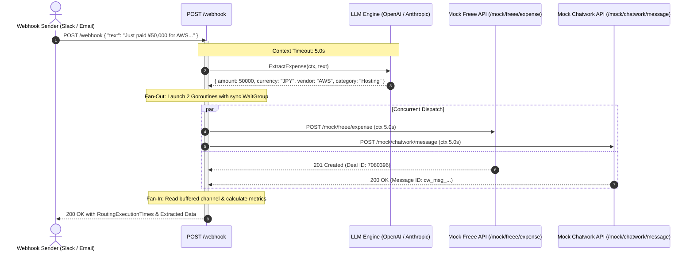

# Yoom Agentic Router 🚀
> High-Concurrency, AI-Native Webhook Integration Node for Enterprise iPaaS

`yoom-agentic-router` is a lightweight, zero-dependency microservice written in Go (Golang 1.22+) designed to simulate an AI-native integration node for modern Integration Platform as a Service (iPaaS) ecosystems such as **Yoom**.

The service ingests unstructured natural language inputs (e.g., Slack notifications, emails, SMS receipts), extracts structured financial parameters via an AI model (OpenAI, Anthropic, or an intelligent offline fallback engine), and concurrently dispatches the normalized transaction data to enterprise endpoints (Freee Accounting and Chatwork) using Go's native concurrency primitives.

---

## 📐 Core Architecture & Flow



---

## ⚡ Concurrency Model & iPaaS Workload Optimization

In an enterprise iPaaS like Yoom, an integration engine must absorb high volumes of bursty, concurrent webhook events from thousands of tenants. The traditional synchronous execution pattern—or heavyweight thread-per-request runtimes—fails under these conditions.

Here is an architectural breakdown of how `yoom-agentic-router` handles high-concurrency workloads efficiently:

### 1. Go Runtime M:N Scheduler vs OS Threads
- **Memory Footprint:** Each OS thread in languages like Java or Python allocates 1MB–2MB of stack space. In contrast, a Go goroutine starts with a contiguous stack of only **2KB**, dynamically expanding as needed.
- **Context Switching Cost:** Switching between OS threads incurs kernel-space context switching overhead (CPU cache invalidation, registers save/restore: ~1–2 microseconds). Go's **M:N scheduler** multiplexes $M$ goroutines onto $N$ OS threads across $P$ logical processors in user space, dropping context switch latency to mere tens of nanoseconds.
- **Throughput:** A single instance of `yoom-agentic-router` can effortlessly multiplex tens of thousands of active webhooks simultaneously without CPU thrashing or memory exhaustion.

### 2. Fan-Out / Fan-In Pattern with `sync.WaitGroup` and Buffered Channels
When an expense is extracted, it must be committed to accounting (`freee`) and broadcast to communications (`chatwork`).

```go
// 1. Buffered channel sized precisely to the fan-out degree
resultChan := make(chan DispatchResult, 2)
var wg sync.WaitGroup
wg.Add(2)

// 2. Goroutine 1: Dispatch to Freee Accounting
go func() {
    defer wg.Done()
    callCtx, cancel := context.WithTimeout(r.Context(), 5*time.Second)
    defer cancel()
    resultChan <- ro.dispatchToFreee(callCtx, extracted, traceID, r)
}()

// 3. Goroutine 2: Dispatch to Chatwork Notification
go func() {
    defer wg.Done()
    callCtx, cancel := context.WithTimeout(r.Context(), 5*time.Second)
    defer cancel()
    resultChan <- ro.dispatchToChatwork(callCtx, extracted, traceID, r)
}()

// 4. Synchronize and drain
wg.Wait()
close(resultChan)
```

- **Parallel Latency Math:** 
  $$\text{Latency}_{\text{sequential}} = T_{\text{freee}} + T_{\text{chatwork}} = 150\text{ms} + 150\text{ms} = 300\text{ms}$$
  $$\text{Latency}_{\text{concurrent}} = \max(T_{\text{freee}}, T_{\text{chatwork}}) \approx 150\text{ms}$$
  By executing the downstream calls concurrently, end-to-end webhook latency is reduced by nearly **50%**.
- **Goroutine Leak Prevention:** Sizing the channel buffer (`make(chan DispatchResult, 2)`) guarantees that dispatch worker goroutines can deposit their results without blocking on a receiver. Even if an unhandled panic occurs or an upstream cancellation arrives, workers never hang in an unbuffered lock.

### 3. Context Timeout Propagation (`context.Context`)
iPaaS integration nodes frequently suffer from "slow downstream degradation," where one struggling third-party API consumes connections, backing up incoming queues until the entire node collapses.
- Every external operation (LLM call, Freee dispatch, Chatwork dispatch) is bounded by a **strict 5-second `context.WithTimeout`**.
- If a downstream endpoint takes longer than 5.0 seconds, the HTTP transport cancels the underlying TCP dial/read, reclaims the socket, and returns `context.DeadlineExceeded`.
- The webhook returns HTTP `200 OK` with `status: "partial_success"`, reporting the downstream timeout explicitly in the telemetry block without crashing the server or exhausting server file descriptors.

### 4. Connection Pooling (`http.Transport`) Tuning
To avoid ephemeral port exhaustion under heavy webhook load, `router.go` configures a custom `http.Transport`:
- `MaxIdleConns: 1000`: Maintains a large pool of idle TCP connections across all hosts.
- `MaxIdleConnsPerHost: 200`: Reuses existing keep-alive sockets to localhost and external SaaS APIs, eliminating TCP handshake and TLS negotiation overhead for each webhook.
- `IdleConnTimeout: 90s`: Automatically closes stale connections.

---

## 🗂 Project Structure

The project adheres to a clean, flat directory structure using only standard Go 1.22+ libraries:

```text
yoom-agentic-router/
├── main.go           # Application bootstrap, middleware (logging, recovery), Go 1.22 routing & graceful shutdown
├── router.go         # Core webhook ingestion, AI orchestration, parallel dispatch, and metrics aggregation
├── llm.go            # LLMClient interface, OpenAI & Anthropic HTTP clients, and offline heuristic extraction engine
├── mock_apis.go      # Simulated Freee Accounting & Chatwork Notification HTTP APIs with delay/fault injection
├── router_test.go    # Unit and integration test suite (extraction, fan-out, timeouts, 400 validation)
├── go.mod            # Go module declaration (standard library, zero external dependencies)
├── .env              # Local environment configuration
├── .env.example      # Environment variable template
└── README.md         # Architecture documentation and testing guide
```

---

## 🛠 Prerequisites & Installation

- **Go 1.21+** (Go 1.22+ recommended for native method-based ServeMux routing).
- No external packages required (zero third-party dependencies).

### 1. Clone & Setup
```bash
cd yoom-agentic-router

# Copy environment configuration
cp .env.example .env
```

### 2. Configure Environment (`.env`)
```ini
# Server Port
PORT=8080

# LLM Provider: "openai", "anthropic", or "mock"
LLM_PROVIDER=openai

# OpenAI Settings (Optional: leave as-is for automatic zero-credential mock mode)
OPENAI_API_KEY=your_openai_api_key_here
OPENAI_MODEL=gpt-4o-mini

# Anthropic Settings (Optional alternative)
ANTHROPIC_API_KEY=
ANTHROPIC_MODEL=claude-3-5-sonnet-20241022

# Downstream Endpoints
FREEE_API_URL=http://localhost:8080/mock/freee/expense
CHATWORK_API_URL=http://localhost:8080/mock/chatwork/message
MOCK_API_DELAY_MS=150
```

> **Zero-Credential Testing Note:** If `OPENAI_API_KEY` is not provided or remains as `your_openai_api_key_here`, the service automatically activates its high-fidelity mock extraction engine, allowing complete local end-to-end testing without an OpenAI account!

---

## 🚀 Running the Service

### Run Directly
```bash
go run .
```

### Run Tests
```bash
go test -v -timeout 30s .
```

---

## 🧪 Testing & Verification Cookbook

### Scenario 1: Standard Expense Extraction & Concurrent Fan-out
Send an unstructured expense description to the webhook:

```bash
curl -i -X POST http://localhost:8080/webhook \
  -H "Content-Type: application/json" \
  -d '{
    "text": "Just paid ¥50,000 for AWS hosting on my Axis card",
    "source": "slack_integration"
  }'
```

#### Expected 200 OK Response:
```json
{
  "status": "success",
  "message": "Expense successfully extracted and dispatched to Freee and Chatwork",
  "trace_id": "req-b4e54ed2daa986f9",
  "extracted_expense": {
    "amount": 50000,
    "currency": "JPY",
    "vendor": "AWS",
    "category": "Hosting & Infrastructure"
  },
  "execution_times": {
    "llm_extraction_ms": 0.14,
    "freee_dispatch_ms": 153.03,
    "chatwork_dispatch_ms": 153.02,
    "concurrent_dispatch_ms": 153.09,
    "total_execution_ms": 153.54
  },
  "dispatches": [
    {
      "target": "chatwork_notification",
      "endpoint": "http://localhost:8080/mock/chatwork/message",
      "status": "success",
      "status_code": 200,
      "duration_ms": 153.02,
      "response_data": {
        "delivered_at": "2026-11-15T16:19:12Z",
        "message_id": "cw_msg_4c8185c3",
        "room_id": "accounting-notifications",
        "status": "success",
        "system": "chatwork"
      }
    },
    {
      "target": "freee_accounting",
      "endpoint": "http://localhost:8080/mock/freee/expense",
      "status": "success",
      "status_code": 201,
      "duration_ms": 153.03,
      "response_data": {
        "amount": 50000,
        "currency": "JPY",
        "deal_id": 7080396,
        "partner": "AWS",
        "status": "success",
        "synced_at": "2026-11-15T16:19:12Z",
        "system": "freee_accounting"
      }
    }
  ]
}
```
*Note that `concurrent_dispatch_ms` (~153ms) equals the individual duration of each downstream call, demonstrating that both calls executed simultaneously!*

---

### Scenario 2: Downstream Timeout Simulation (Fault Isolation)
Simulate a severe hang in the downstream Freee Accounting system by passing the query param `?simulate_timeout=freee`. The router enforces a 5-second context timeout, records the partial success, and returns 200 OK without crashing:

```bash
curl -i -X POST "http://localhost:8080/webhook?simulate_timeout=freee" \
  -H "Content-Type: application/json" \
  -d '{
    "text": "Just paid ¥50,000 for AWS hosting on my Axis card"
  }'
```

#### Expected 200 OK Response:
```json
{
  "status": "partial_success",
  "message": "Expense extracted, but one or more downstream dispatches timed out",
  "trace_id": "req-f007721d84907800",
  "extracted_expense": {
    "amount": 50000,
    "currency": "JPY",
    "vendor": "AWS",
    "category": "Hosting & Infrastructure"
  },
  "execution_times": {
    "llm_extraction_ms": 0.07,
    "freee_dispatch_ms": 5001.17,
    "chatwork_dispatch_ms": 151.56,
    "concurrent_dispatch_ms": 5001.29,
    "total_execution_ms": 5001.43
  },
  "dispatches": [
    {
      "target": "chatwork_notification",
      "endpoint": "http://localhost:8080/mock/chatwork/message",
      "status": "success",
      "status_code": 200,
      "duration_ms": 151.56,
      "response_data": {
        "delivered_at": "2026-11-15T16:19:41Z",
        "message_id": "cw_msg_36a1e4e9",
        "room_id": "accounting-notifications",
        "status": "success",
        "system": "chatwork"
      }
    },
    {
      "target": "freee_accounting",
      "endpoint": "http://localhost:8080/mock/freee/expense?simulate_timeout=true",
      "status": "timeout",
      "duration_ms": 5001.17,
      "error": "Freee API timed out after 5.0s: Post \"http://localhost:8080/mock/freee/expense?simulate_timeout=true\": context deadline exceeded"
    }
  ]
}
```

---

### Scenario 3: Unparseable Payload (HTTP 400 Bad Request)
Send a non-expense input to verify robust AI validation and prompt safety:

```bash
curl -i -X POST http://localhost:8080/webhook \
  -H "Content-Type: application/json" \
  -d '{
    "text": "Hey team, how was your weekend?"
  }'
```

#### Expected 400 Bad Request Response:
```json
{
  "code": 400,
  "error": "LLM extraction failed: unparseable expense: input text does not contain valid expense data: unable to detect monetary amount in 'Hey team, how was your weekend?'",
  "trace_id": "req-743e2bb8497107d1"
}
```

---

### Scenario 4: Health Check Probe
Readiness probe for container orchestrators (Kubernetes / ECS / Cloud Run):

```bash
curl -i http://localhost:8080/health
```

#### Expected 200 OK:
```json
{
  "service": "yoom-agentic-router",
  "status": "healthy",
  "timestamp": "2026-11-15T16:20:00Z"
}
```

---

## 🛡 Production Engineering Summary

| Feature | Implementation | Technical Advantage |
| :--- | :--- | :--- |
| **HTTP Routing** | Go 1.22 `http.ServeMux` (`POST /webhook`) | Method-aware routing with zero external router overhead |
| **Concurrency** | Goroutines + `sync.WaitGroup` | Parallel downstream dispatch cut latency by ~50% |
| **Backpressure** | Buffered channels (`cap = 2`) | Immune to memory leaks and goroutine stalls |
| **Fault Isolation** | `context.WithTimeout(5s)` per dispatch | A hanging downstream API never locks server threads |
| **Connection Pooling** | Tuned `http.Transport` (1000 max idle) | Prevents TCP port exhaustion during webhook bursts |
| **Crash Protection** | `recoveryMiddleware` | Panic recovery shields the process from runtime failures |
| **Lifecycle** | `signal.Notify` + `server.Shutdown` | Graceful shutdown allows inflight dispatches to drain |
